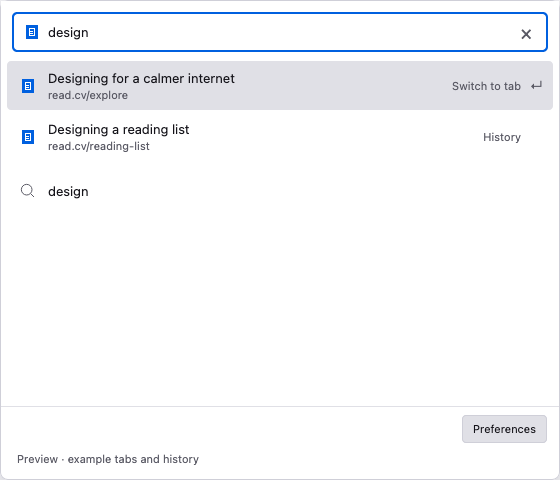

# Search or Switch

[](https://github.com/rutgerkra/search-or-switch/actions/workflows/ci.yml)

An Arc-inspired, keyboard-first tab switcher for Firefox. Open the popup, type, and press Enter to switch to an open tab, revisit a page, open a URL, or search the web.



## Features

- Search open tabs in the current window, with browsing-history suggestions below them.
- Preview destinations with the arrow keys, including locally cached favicons.
- Search using Firefox’s default search engine.
- Open a typed URL with Enter; its address is always first. Web search is second whenever another result is available.
- Press **Tab** on a site hint to search that site. Firefox-installed engines are available immediately; automatic discovery can learn supported searches after you grant website access.
- Create a tab only when you commit an address or search. Reuse the current Firefox Home/New Tab page when available.
- Open with **Shift+Cmd+K** on macOS, **Ctrl+Shift+K** on Windows, or **Ctrl+Shift+Space** on Linux, or use the toolbar button.
- Edit, clear, or restore the shortcut and control automatic site-search discovery in Firefox-style Preferences.
- Follow the system’s light or dark appearance.

Built with plain HTML, CSS, and JavaScript, with no runtime dependencies or remote UI assets.

## Try it

This project is in development and is not yet published on Mozilla Add-ons. It targets **Firefox Desktop 140+**.

1. Download or clone this repository.
2. In Firefox, open `about:debugging#/runtime/this-firefox`.
3. Choose **Load Temporary Add-on…** and select `manifest.json` from the project folder.
4. Press **Shift+Cmd+K** (macOS), **Ctrl+Shift+K** (Windows), or **Ctrl+Shift+Space** (Linux), or click **Search or Switch** in the toolbar.

Pin the toolbar button for the wider popup layout. A temporary installation lasts until Firefox restarts. After changing source files, click **Reload** in `about:debugging` and reopen the popup.

## Controls

| Action | Behavior |
| --- | --- |
| Type | Match tab and history titles, hostnames, and URLs. |
| ↑ / ↓ | Select a result and preview its full URL in the input. Returning to the search action restores your original query. |
| Tab on a site hint | Enter a dedicated site-search mode. Type your query after the site chip. |
| Enter | Commit the selected result and close the popup. |
| Cmd+Enter / Ctrl+Enter | Open the displayed address or search, even when a tab matches. In site-search mode, search the selected site. |
| Backspace in an empty site query | Leave site-search mode and restore the prefix that selected the site. |
| Click the site chip | Leave site-search mode and restore the original prefix. |
| Escape | Dismiss Firefox’s native popup. Use empty Backspace or the site chip to leave site mode while keeping the popup open. |
| Preferences | Edit, clear, or restore the shortcut; control automatic discovery, allow website access, or clear learned searches. |

Firefox anchors the popup to its toolbar. Opening, typing, and dismissing it create no tabs. Switching to a tab preserves existing browsing tabs. Firefox’s normal new-tab shortcut and page remain unchanged.

A site hint is independent of the highlighted tab or history result. For example, type `you` and press **Tab** when YouTube is offered, then type a query and press **Enter** to open its results page. Dedicated site-search mode hides tab and history results. Each popup starts in ordinary search mode. Ordinary web searches keep using Firefox’s current default engine.

**Automatic site discovery** is on by default, but learning requires optional HTTP(S) website access. When access is missing, a prompt below the search field offers **Allow website access** and **Turn off discovery**. Down focuses Allow; Left/Right switches buttons; Enter/Space activates; Down continues to results and Up returns to search. Both buttons also support Tab/Shift+Tab. The prompt preserves your query and remains visible after a refusal, without an extra error. Website access can also be granted in Preferences.

Approving access scans existing normal tabs and learns supported searches on future visits. Declining leaves the discovery preference unchanged and does not start learning; installed engines still work. Learned sites become available immediately. Discovery accepts standard OpenSearch GET results-page templates and unambiguous GET search forms; it does not infer JavaScript or POST searches. Turning discovery off or revoking access stops learning and retains learned searches. **Clear learned searches** removes only learned sites, leaving the toggle, website-access grants, and Firefox-installed engines unchanged; sites can be learned again on later visits while discovery is on and access is granted.

## Privacy and permissions

Matching happens locally. There are no analytics, remote suggestions, or favicon requests.

| Permission | Purpose |
| --- | --- |
| `tabs` | Match open-tab titles and URLs in the current window. |
| `history` | Find previously visited pages while you type. The extension never adds, deletes, or stores history records. |
| `search` | List Firefox-installed search engines and submit a query you commit to the default or selected installed engine. |
| `storage` | Keep a bounded cache of browser-supplied favicons, the discovery preference, and learned site-search definitions. |
| `scripting` | Extract supported search metadata from normal pages when automatic discovery has page access. |
| Optional HTTP(S) page access | Learn search definitions from visited sites and fetch their advertised OpenSearch metadata when discovery is on and you approve **Allow website access**. |

The icon cache contains at most 64 site origins and inline images, each limited to 64 KiB. Learned search definitions store only local names, keywords, origins, and reusable search templates. The extension saves no entered queries, user-entered input values, full visited URLs, or query history, and uses no sync storage. It does not discover searches in private windows; private-window icons stay in popup memory. History results and tab titles are not persisted. The popup blocks network connections; the background discovery service can fetch HTTP(S) search metadata with granted page access.

Firefox’s public history API does not supply favicons. History results show a cached icon when the extension has observed one from an open tab; otherwise they show a globe.

## Development

Use **Node.js 22.12 or newer**. The default checks require no package installation.

```sh
git clone https://github.com/rutgerkra/search-or-switch.git
cd search-or-switch
npm test             # Unit tests
npm run check        # Manifest, syntax, CSP, and UI references
npm run dev          # Browser preview at http://127.0.0.1:4173
npm run build        # Unpacked extension and unsigned ZIP in dist/
```

The preview embeds the actual popup page at its native dimensions, with the example-data label outside the panel. It uses example data and does not control real tabs. Loading `manifest.json` directly in Firefox requires no build step. The ZIP is unsigned; permanent Firefox distribution requires Mozilla signing.

After the initial Mozilla Add-ons listing and API secrets are configured, successful pushes to `main` submit an update only when `manifest.json` has a version newer than previous Mozilla submissions. See [publishing setup and release behavior](docs/PUBLISHING.md).

Optional isolated Firefox UI checks use `puppeteer-core`:

```sh
npm install --no-save --package-lock=false puppeteer-core@25.17.0
npm run test:ui
npm run screenshots  # Refresh main preview and store screenshot from the current UI
npm run test:firefox  # Python 3 and desktop Firefox; disposable profile
```

See [CONTRIBUTING.md](CONTRIBUTING.md) for development and validation guidance, the [development reference](docs/DEVELOPMENT.md) for implementation details, and the [site-search spec](docs/SITE_SEARCH.md) for the interaction and discovery contract.

The test suite includes unit tests, isolated Firefox UI checks, and real content-script discovery checks in a disposable profile. Firefox 160 on macOS passed physical shortcut → immediate typing → Tab into a site chip, the website-access prompt, OpenSearch discovery, and a local site-search commit with encoded terms and popup dismissal. The existing native selection, history, and tab-reuse flows also have baseline coverage. Firefox reserves native Escape for closing the popup; the intended first-Escape mode exit is a [documented platform exception](docs/SITE_SEARCH.md). Firefox 140 and other operating systems still need native verification.

## License

[MIT](LICENSE) © 2026 Rutger Kraaijer.
